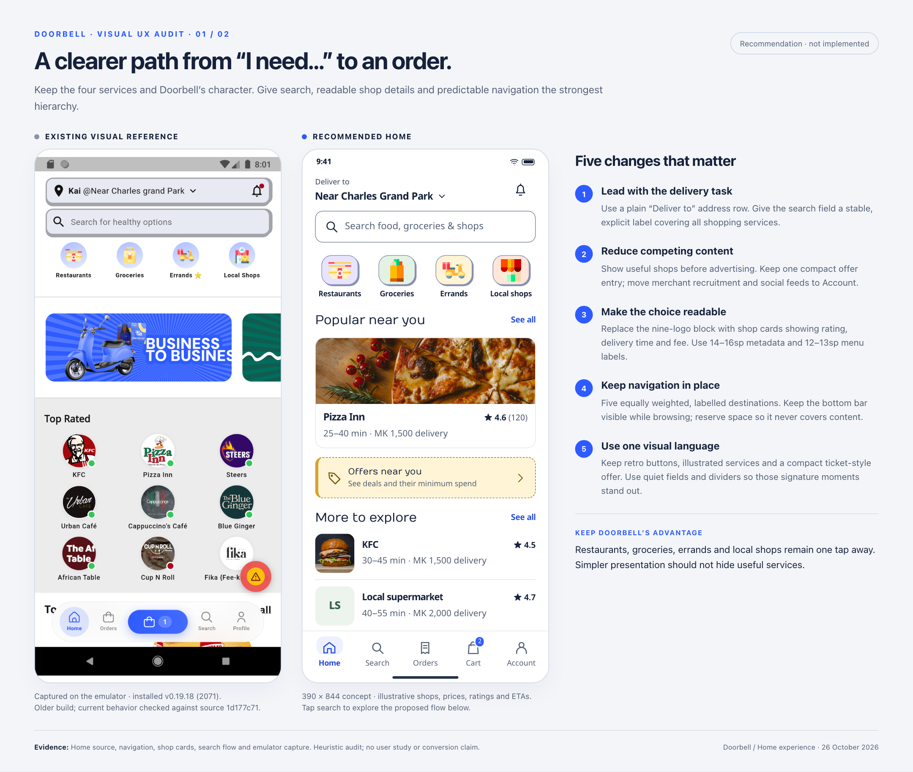
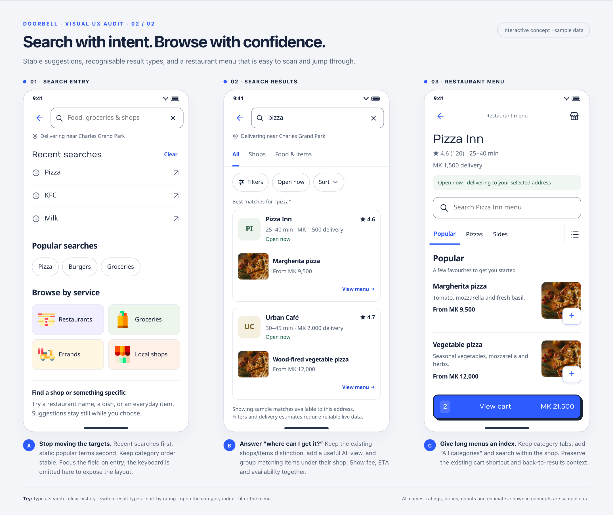

# Product improvement proposals

Reviewable audits and visual proposals for Doorbell. Each proposal documents the current experience, recommended changes, evidence, implementation priorities and validation criteria. These are design proposals, not shipped features.

| Proposal | Status | Scope |
|---|---|---|
| [Character & feedback](brand-character/README.md) | Proposed — awaiting review | Retro buttons, paired typography, service illustrations and interactive feedback states |
| [Home page experience](home-page/audit.md) | Proposed — awaiting review | Ease of use, reduced clutter, legibility, navigation, search and restaurant menus |
| [App-wide consistency](app-consistency/README.md) | Proposed — awaiting review | Remaining page families: shopping, checkout/payment, orders, errands, account, onboarding and supporting states |
| [Shared design language](design-language.md) | Proposed — awaiting review | Reusable typography, colour, spacing, navigation, forms, cards, action and state contracts |

## Character and feedback refinement

The updated direction keeps Doorbell’s retro feel while preserving the clearer hierarchy. Start with the [comparison and interactive button demo](brand-character/README.md); the Home and app-wide boards now use the same outlined actions, hard shadows, Numans/Nokora pairing and existing service artwork. Shared fonts and illustrations are bundled in `assets/` for offline review.

## App-wide follow-up

The [consistency review](app-consistency/README.md) extends this proposal across the remaining journeys with twelve representative phone layouts, a source-linked audit and a [112-file coverage inventory](app-consistency/inventory.md). Start with the [shared design language](design-language.md) to review common component decisions, then use the journey boards and findings to agree page-specific work. The follow-up distinguishes active flows from legacy or placeholder routes and records which behavior still needs runtime verification.

## Home page experience

The recommendation is to keep Doorbell's four core services while making discovery calmer and navigation more predictable. Start with persistent navigation, readable labels and a simpler Home feed; introduce richer search and menu features after confirming their data requirements.

Read the [full audit](home-page/audit.md) for source-linked findings, competitor references, priorities and acceptance checks. The existing-screen reference comes from an older installed build; the audit distinguishes it from the current source review. All prices, ratings and estimates in the concepts are illustrative.

### Home comparison

### Search and restaurant menus

### Interactive review

Open [home-page/index.html](home-page/index.html) locally in a browser after checking out this branch. GitHub displays HTML source rather than running the interactive concept. Keep the adjacent `assets/` folder and the shared `../assets/` folder with the HTML; no build step or server is required.

Try entering and clearing a query, clearing history, switching result types, sorting by rating, opening the menu category index and filtering menu items. The demo uses sample data and explanatory messages for actions outside its scope; it does not place orders or call production APIs. The HTML is also the source for the two visual boards above.

### Review decisions

- [ ] Agree the Home hierarchy: delivery context → search → four services → useful shops → compact offers → more shops, with active-order status shown when relevant.
- [ ] Confirm persistent **Home / Search / Orders / Cart / Account** navigation while preserving existing guest gates and multiple carts.
- [ ] Agree larger labels, consistent shop details and reduced decorative motion.
- [ ] Confirm moving merchant recruitment and social links into Account while retaining critical service notices.
- [ ] Agree the search direction: recent history, stable suggestions, All / Shops / Food & items and recoverable empty/error states.
- [ ] Identify API/data work for full search results, address-level availability, filters and reliable delivery estimates.
- [ ] Confirm restaurant menu search and a full category index.

Record decisions in the PR discussion; unchecked boxes are review prompts, not unfinished implementation tasks in this documentation change. Any approved application changes should be scoped separately using the audit's implementation sequence and acceptance checks.

### Supporting material

- [Existing Home capture](home-page/assets/current-home.png)
- [Existing offline-state capture](home-page/assets/current-home-offline.png)
- [Scope, confidence and image provenance](home-page/audit.md#scope-and-confidence)
- [Implementation sequence and validation](home-page/audit.md#delivery-sequence-and-validation)

Proposal date: 26 October 2026. The audit records the reviewed source commit and installed build version; findings should be rechecked if the implementation changes before this proposal is adopted.
