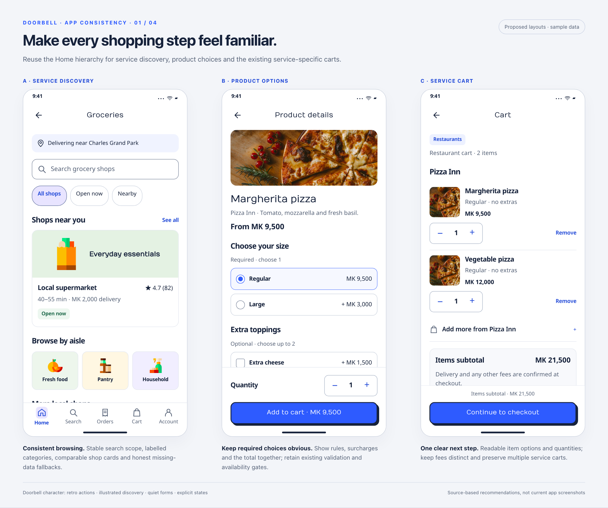
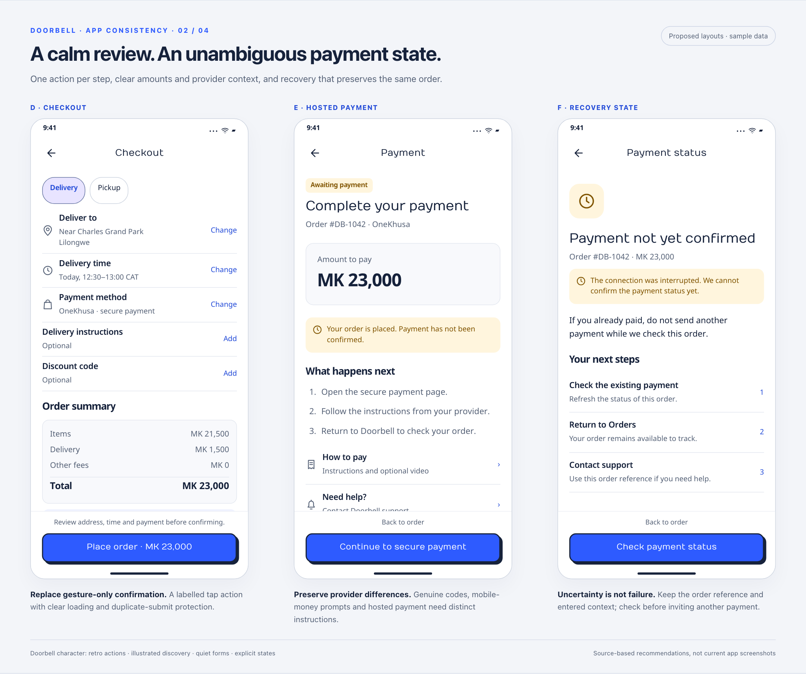
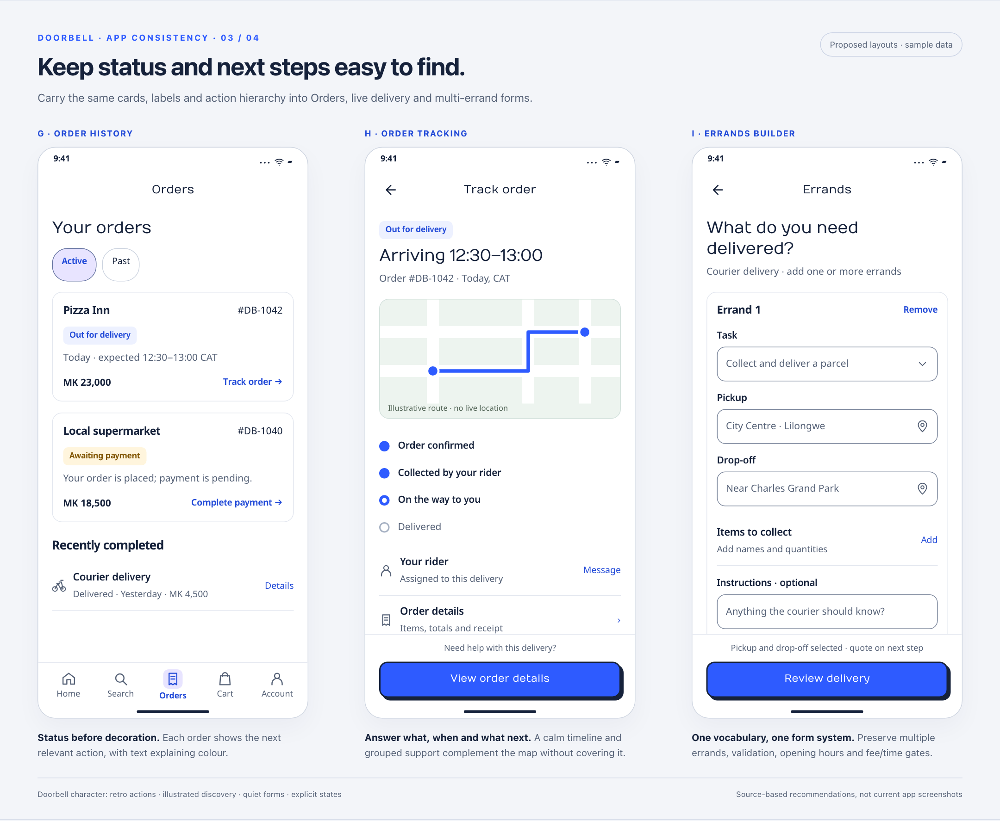
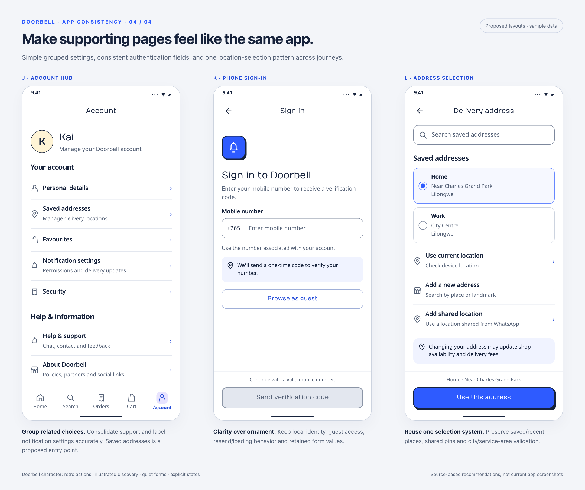

# App-wide consistency review

The Home direction should carry through the whole task, from discovery to payment and delivery. This follow-up finds substantial differences in shared controls, typography, forms and state presentation across the remaining page families.

[Full source-linked audit](audit.md) · [Shared design language](../design-language.md) · [112-file coverage inventory](inventory.md) · [Local visual concepts](index.html)

This is a documentation proposal. Findings are source-based; the boards below are proposed layouts with illustrative data, not current-build screenshots or a working payment flow. The inventory separates live page families, supporting files, previously audited Home/search/menu code, and legacy/unproven routes. Runtime and accessibility verification of the Flutter app remains part of implementation acceptance.

## Character retained

The revised boards restore retro primary buttons, Numans actions/selected headings, Nokora reading text and existing service illustrations. Forms and status panels remain quiet. The [character comparison and feedback demo](../brand-character/README.md) shows the earlier flat proposal beside the revised direction, plus pressed, focus, loading and disabled states.

## Recommended implementation order

| Order | Work | Why |
|---|---|---|
| 1 | Shared buttons, text roles, app bars, fields, status colours and state panels | Prevent each screen from solving the same design problem differently |
| 2 | Product → cart → checkout → payment → order status | Keep the most consequential journey consistent, including failure and recovery |
| 3 | Service discovery, addresses and multi-errand forms | Reuse the same search, selection, card and form patterns while keeping service-specific behavior |
| 4 | Account, notifications, offers, rating, onboarding and system states | Complete secondary surfaces and resolve legacy route ownership |

Prioritise accessible confirmation, loading-action guards, small back/close controls, clear payment states and warning-sheet reflow. Keep existing validation, provider handling, guest gates, multiple carts and quote/time restrictions.

## Shopping

## Checkout and payment

## Orders and errands

## Account and access

## What the boards represent

The twelve phone layouts illustrate reusable patterns; every page family is addressed in the audit, but every page/state is not given a separate mockup. Offers, notification settings, favourites, affiliates, rating, legal/consent and blocking system screens inherit the documented components and have specific recommendations in the audit. The HTML bundles Numans and Nokora for offline review; the shared specification gives each family a deliberate role. Dark-mode tokens are specified in the shared language, but dark-mode runtime rendering has not been verified.

Open `index.html` locally to view the boards with independently scrollable phone content. The depicted phone controls are static illustrations. The review navigation links are functional. No build, service account or server is required; keep `concept.css`, the shared `../assets/` folder and the sibling `home-page/assets/` image folder in place. GitHub renders the PNG boards above and shows source when opening HTML.

## Decisions for this PR

- [ ] Adopt the shared typography, spacing, colour and component contracts, retaining retro actions and illustrated discovery, including dark-mode and large-text requirements.
- [ ] Replace gesture-only checkout confirmation or provide an equivalent accessible confirmation action.
- [ ] Preserve distinct pending, unknown, failed and successful payment states and the same-order recovery path.
- [ ] Agree consistent navigation semantics for main destinations, focused tasks and sheets.
- [ ] Agree one product/quantity/card/selection pattern across restaurants, groceries, local shops, cart and favourites.
- [ ] Agree Errands terminology and flatter multi-errand forms without removing existing task options.
- [ ] Confirm the proposed Active / Past order grouping and Saved addresses account entry; both need behavior/routing work beyond visual restyling.
- [ ] Separate notification permissions from an actual inbox; remove/de-route placeholder content or explicitly scope its implementation.
- [ ] Confirm legacy page ownership before restyling or reconnecting unproven routes.

Unchecked boxes are design review prompts, not implementation tasks expected to ship in this PR. Use the [audit's journey acceptance matrix](audit.md#implementation-order-and-acceptance) for subsequent application changes.

## Artifact validation

The twelve concepts were rendered in headless Chromium and all four exported boards were visually inspected. Image decoding passed; the gallery had no JavaScript page errors or horizontal page overflow at 360, 390 and 412 CSS pixels. Local documentation targets, 191 pinned source links (file existence and line bounds), and the exact 112-file inventory were checked. These checks validate the review material, not native Flutter behavior, screen-reader support or production payment flows.
