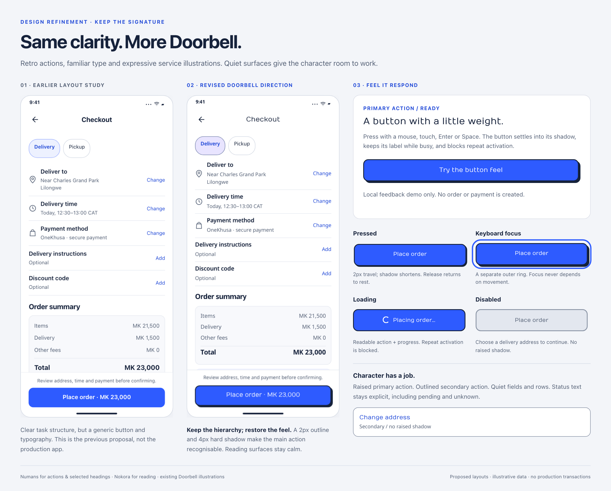

# Keep Doorbell's character

The revised direction keeps the clearer layouts while restoring the original retro feel: outlined primary buttons with hard shadows, tactile press feedback, Numans actions/headings, Nokora reading text and existing service illustrations.

[Open the local comparison and feedback demo](index.html) · [Shared specification](../design-language.md#character-and-visual-feedback) · [Home/search/menu](../home-page/index.html) · [All journey concepts](../app-consistency/README.md)

The left phone is the earlier flat proposal, not the current production app. The right phone is the revised proposal; both use illustrative order data. The app-wide gallery and Home/search/menu boards are updated to this same direction.

## What carries the personality

| Keep | Apply deliberately |
|---|---|
| Retro primary buttons | 2px dark outline, 4px down/right hard shadow, 12px corners; one main action per task |
| Physical press response | 2px travel and shorter shadow; release/cancel resets without shifting surrounding content |
| Familiar typography | Numans for actions and selected headings; Nokora for names, prices, forms and reading |
| Illustrated service tiles | Existing restaurant, grocery, courier and shop artwork, with pastel accents |
| Offer character | Compact ticket treatment and warm colour; readable conditions, no persistent shimmer |
| Local identity | Preserve existing illustrations and voice without adding unsupported marketing claims |

Secondary actions, fields, rows and order summaries stay quiet. Pending, unknown, failed and successful states remain explicitly labelled; colour and animation do not substitute for status text.

## Review the feedback

Open `index.html` locally and press **Try the button feel** using a mouse, touch, Enter or Space. The demo blocks repeat activation, retains an in-progress label, then announces completion of the demonstration. It creates no order, payment or external request. The neighbouring pressed/focus examples are static state illustrations; the loading and disabled examples are intentionally inactive.

Enable your browser/OS reduced-motion preference to remove press translation and transitions while preserving colour and keyboard-focus feedback. The native Flutter equivalent still needs implementation and platform accessibility testing.

This folder depends on the shared `../assets/` styles/fonts and its own `assets/` images. All dependencies are local; keep the folder structure intact. Fonts include their license files and illustrations are copied unchanged from the app; see [asset provenance](../assets/README.md).

## Review criteria

- The primary action is recognisable as Doorbell before reading its label.
- Discovery has more visual expression than checkout and settings.
- Button labels remain readable during loading and at narrow widths.
- Disabled controls have a nearby explanation and no raised shadow.
- Focus is visible without relying on movement; reduced motion preserves feedback.
- Hard shadows never compete across every row, input and status panel.

The previous recommendation to flatten all primary buttons and remove Numans is superseded by this direction. The audit's usability and behavior findings still apply.

## Validation

Rendered and visually reviewed the comparison plus all six refreshed journey/Home boards in Chromium. The local demo passed mouse, Enter and Space activation, focus-ring, pressed-state, busy-state and completion checks, including reduced motion. All three galleries passed horizontal-overflow checks at 360/390/412 CSS pixels with bundled fonts and images loaded; no page errors or external network requests were recorded. Existing Home search, sorting, category-index and empty-result interactions were rechecked. These checks cover the browser review material, not Flutter runtime or assistive-technology certification.
